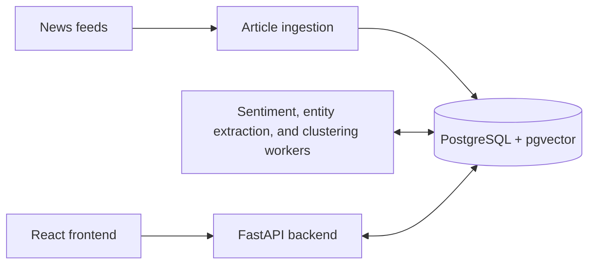

# Sentio

**Explore the news. Understand the sentiment. See what's driving the story.**

Sentio is a news intelligence platform that turns recent news coverage into an interactive view of sentiment, emerging themes, and the entities behind the headlines. Search for a company, person, market topic, or keyword to explore how it is being covered and how that coverage changes over time.

This repository contains the **Sentio web frontend**. News collection, natural-language processing, and analytical APIs are handled by separate backend services.

## Features

- **Search and explore** — Enter a keyword or natural-language prompt and explore the resulting news coverage.
- **Sentiment dashboard** — View sentiment distribution, changes in tone, article volume, and recent headlines for a selected time window.
- **What's driving this?** — Explore groups of related articles to understand the stories contributing to the overall picture.
- **Entity insights** — Discover frequently mentioned companies, people, and other entities, and navigate directly to their coverage.
- **Watchlist** — Follow entities of interest and revisit their latest metrics in one place.
- **Comparison** — Compare coverage and sentiment across selected subjects.
- **Source and coverage views** — Explore information about the news sources and the available coverage.
- **Responsive interface** — Use the dashboard across desktop and mobile screen sizes.

## How Sentio works

At a high level, the platform combines news ingestion, language processing, and a searchable frontend:



The backend collects articles and processes them for sentiment, named entities, and semantic similarity. Related articles can be clustered to surface the main stories behind a topic. The frontend requests aggregated results from the API and presents them as interactive visualizations and article lists.

Sentio focuses on **recent news coverage**, with an emphasis on European sources. Results reflect the articles available in the system for the chosen search and time window; they are not a measure of public opinion or a prediction of future events.

## Technology

| Area | Technologies |
| --- | --- |
| Frontend | React 19, TypeScript, Vite |
| Styling and UI | Tailwind CSS v4, Radix-based components |
| Navigation | React Router |
| Charts | Chart.js, `react-chartjs-2` |
| Backend services (separate repository) | Python, FastAPI, PostgreSQL, pgvector |
| Analysis (backend) | Sentiment analysis, named-entity recognition, embeddings, and article clustering |

## Getting started

### Prerequisites

- Node.js and npm
- Access to a running Sentio API

The backend is maintained separately from this repository. API access and endpoint information are provided by the project maintainer.

### Run locally

1. Install dependencies:

   ```bash
   npm install
   ```

2. Configure the API endpoint in a local `.env` file (you can start from `.env.example`):

   ```dotenv
   VITE_SENTIO_API_BASE_URL=https://your-api.example.com/sentio
   ```

   Replace the example URL with the endpoint you have been given.

3. Start the development server:

   ```bash
   npm run dev
   ```

4. Open the local URL printed by Vite in your terminal.

### Available commands

| Command | Description |
| --- | --- |
| `npm run dev` | Start the development server |
| `npm run build` | Create a production build |
| `npm run preview` | Preview a production build locally |
| `npm run lint` | Run lint checks |

## Repository structure

The frontend is organized by route-level pages, reusable components, hooks, and shared utilities:

```text
src/
  components/   # Dashboard, analysis, search, and shared UI components
  config/       # API and application configuration
  hooks/        # Data fetching, search, and application hooks
  lib/          # Shared helpers and utilities
  pages/        # Route-level screens (Home, Dashboard, Watchlist, etc.)
```

The frontend communicates with Sentio APIs for query resolution, search results, sentiment metrics, and other analytics. It does not run ingestion or NLP processing locally.

## Project scope

Sentio is an actively developed project focused on helping people examine **what the news is saying, how the tone is changing, and which stories are influencing that change**. The current application is designed for exploration and analysis rather than financial advice or automated decision-making.
